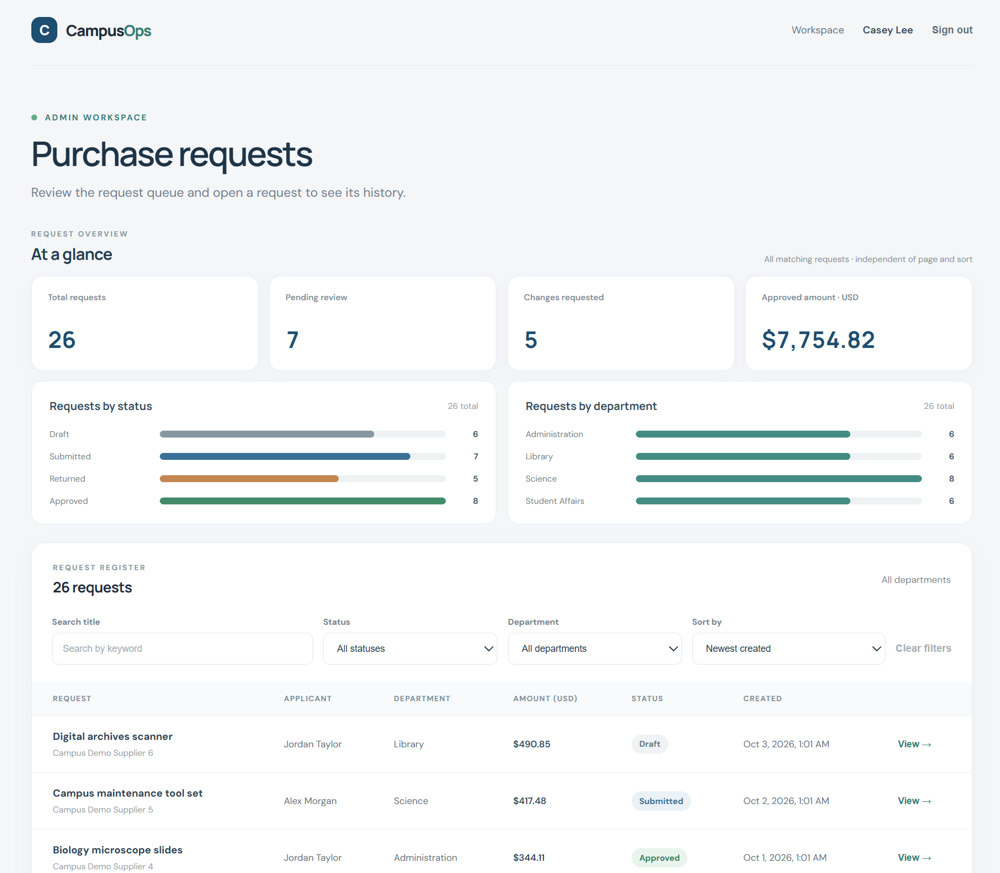
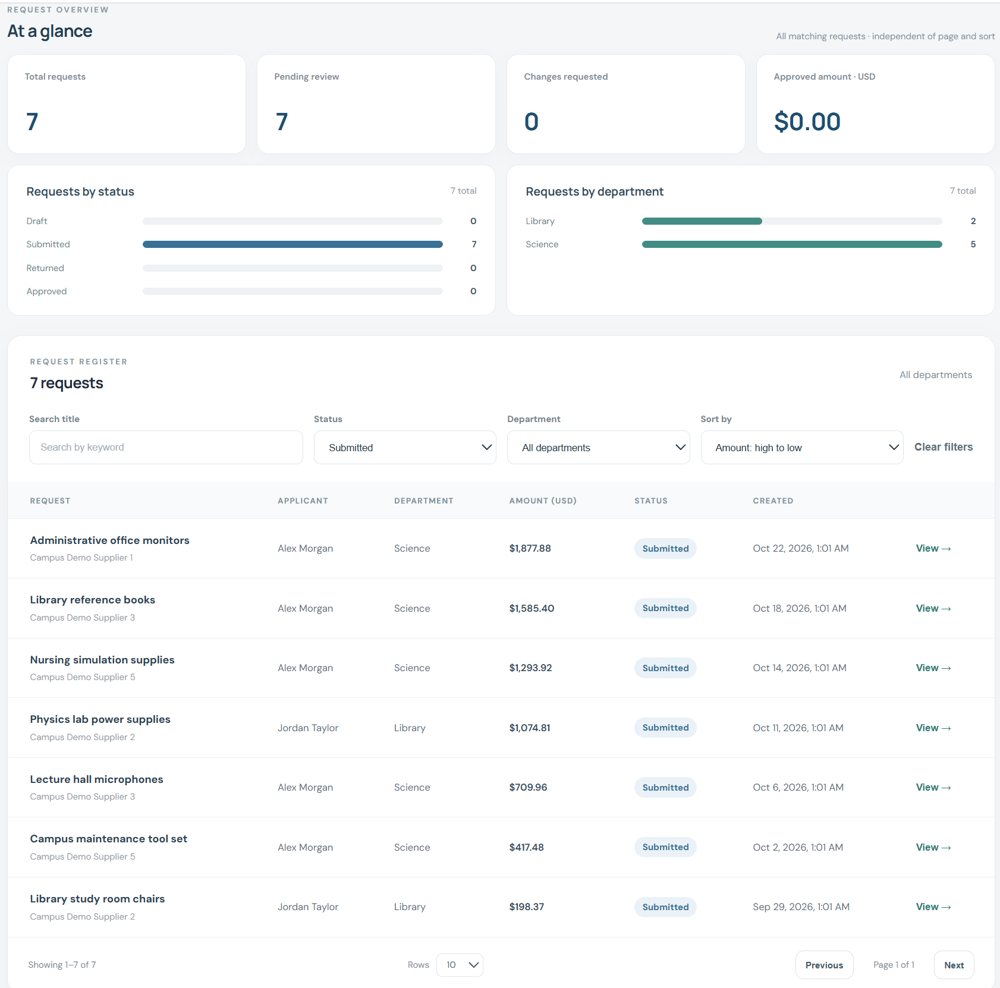
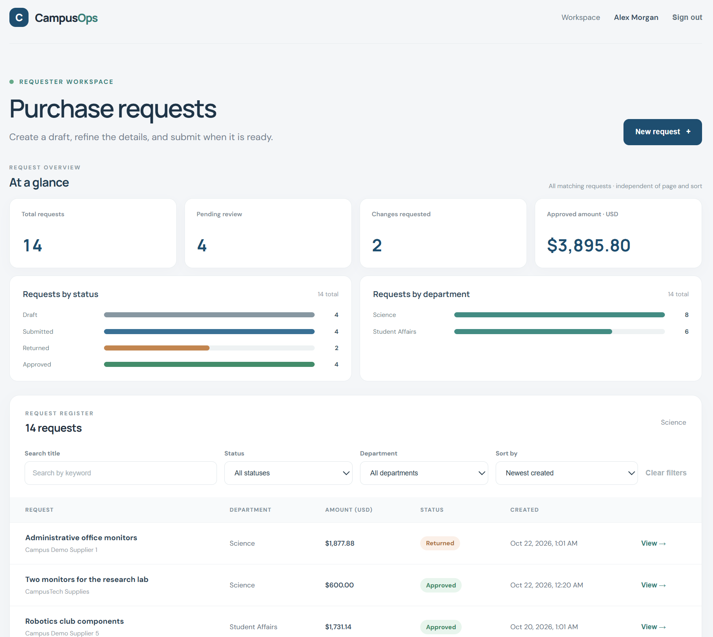
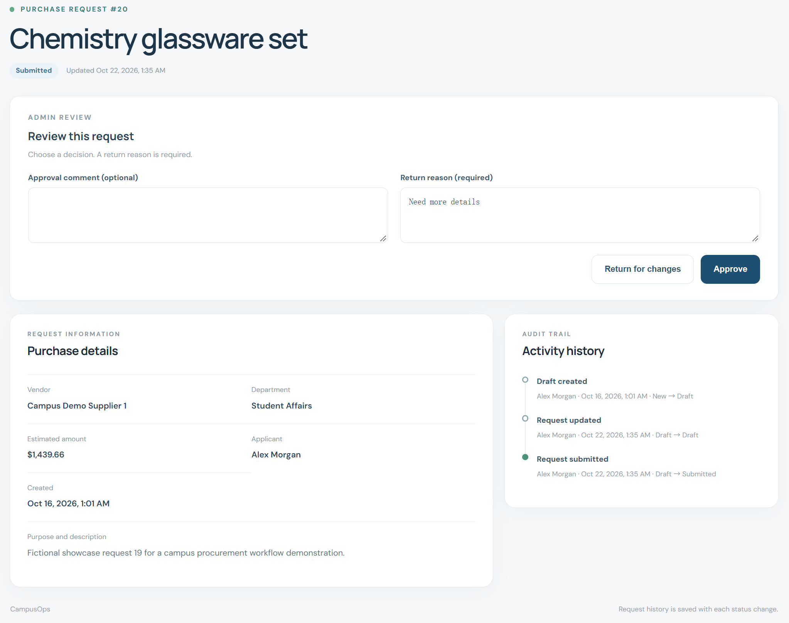
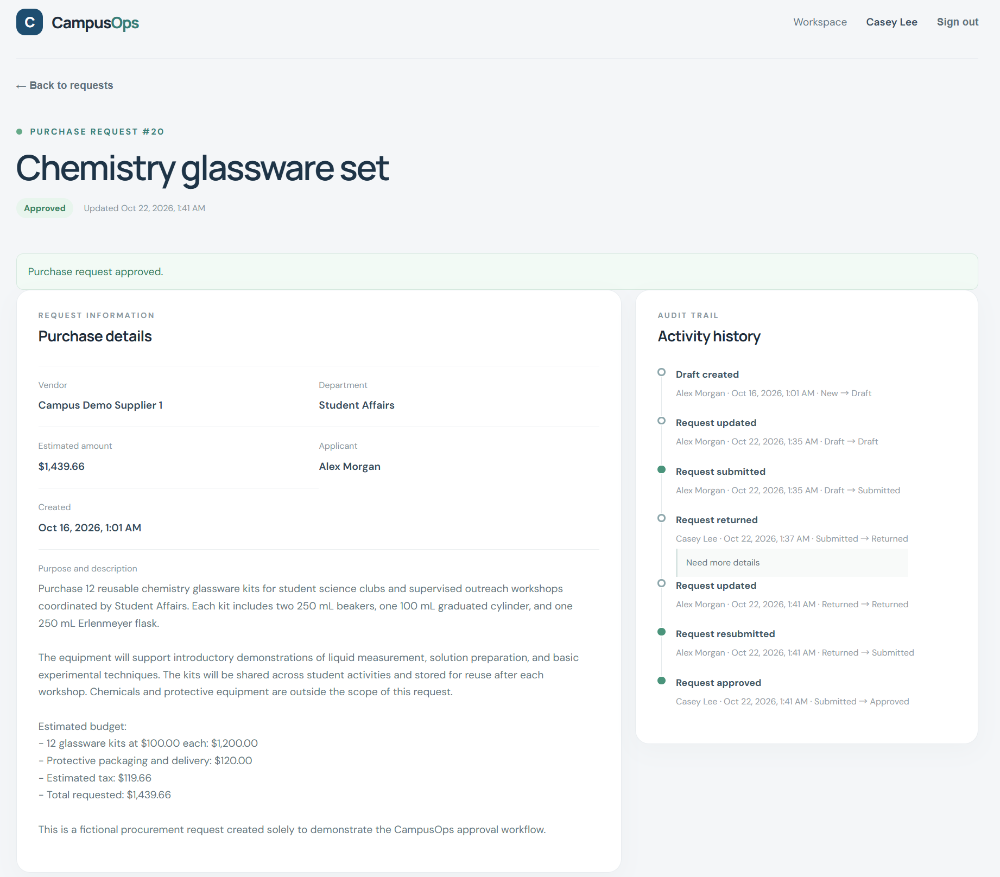

# CampusOps

CampusOps is an independent software development demonstration of a campus procurement request and review workflow. It brings request entry, administrator decisions, and the record of those decisions into one small web application. It has not been deployed or approved for use by any school and is not intended for real procurement decisions.

## Project overview

The intended users are campus staff or departments requesting supplies and administrators reviewing those requests. Requesters can create and manage their own drafts, submit requests, respond to returns, and view their request history. Administrators can search and review all requests, approve or return submissions, and inspect the complete history.

The React and TypeScript single-page application calls a Python FastAPI REST API. FastAPI verifies an opaque, server-side session cookie and CSRF token, applies ownership and role checks, and uses PostgreSQL for users, departments, requests, sessions, and activity history. Passwords are stored as Argon2 hashes. Versioned SQL migrations evolve the schema without rebuilding the database.

## Features and permissions

| Role | Available actions |
|---|---|
| Requester | Create and edit own Draft requests; optionally upload, replace, or delete one quotation PDF on Draft or Returned requests; submit Draft requests; edit Returned requests and explicitly resubmit; view own requests and histories. |
| Administrator | View and search all requests; approve or return Submitted requests; view request histories and quotation PDFs; export matching requests to CSV. |

Submitted and Approved requests cannot be edited. A return requires a reason. Status changes and their history events are saved in one database transaction. The workspace includes server-side search, status and department filters, creation-time and amount sorting, pagination, and filtered aggregate request overviews.

## Technology stack

- Frontend: React 19, TypeScript 5.8, Vite 6
- Backend: Python 3.11, FastAPI, Pydantic, psycopg 3
- Database: PostgreSQL 18
- Authentication: Argon2 password hashing, server-side sessions, and CSRF protection
- Tests: pytest with a separate `campusops_test` database

## Requirements

- Python 3.11
- Node.js 22 and npm
- PostgreSQL 18

## First-time setup

Before starting, use pgAdmin or a local PostgreSQL administrator to create a `campusops_app` login role and an empty `campusops` database owned by that role. Set the role password locally in PostgreSQL; never paste it into source code or documentation.

Create `D:\code\campusops\.env` by copying `.env.example`. Set `PGHOST`, `PGPORT`, `PGDATABASE`, `PGUSER`, and `PGPASSWORD` for that local database (`PGDATABASE=campusops`, `PGUSER=campusops_app`). Keep the database password in this local file only. The driver receives connection fields separately, so password characters do not need URL encoding. The `.env` file is excluded from Git.

```powershell
cd D:\code\campusops
Copy-Item .env.example .env
```

Open `.env` in a local editor and replace only the password placeholder with the PostgreSQL role password. Do not share that file.

In PowerShell:

```powershell
cd D:\code\campusops
python -m venv .venv
cd backend
..\.venv\Scripts\python.exe -m pip install -r requirements-dev.txt
..\.venv\Scripts\python.exe -m app.migrate
..\.venv\Scripts\python.exe -m app.seed_demo
```

Migrations are versioned and applied in order. They add tables and indexes without dropping or recreating the database. The demo seed can be run again safely.

Install frontend dependencies once:

```powershell
cd D:\code\campusops\frontend
npm install
```

## Daily startup

In one PowerShell window:

```powershell
cd D:\code\campusops\backend
..\.venv\Scripts\python.exe -m uvicorn app.main:app --reload --port 8000
```

In a second PowerShell window:

```powershell
cd D:\code\campusops\frontend
npm run dev
```

Open `http://127.0.0.1:5173`. The API health check is at `http://127.0.0.1:8000/api/health`; it runs a real `SELECT 1` query and returns HTTP 503 if PostgreSQL is unavailable. Interactive API documentation is at `http://127.0.0.1:8000/docs`.

## Demo accounts

Run `python -m app.seed_demo` from the `backend` directory to create or refresh these local demo accounts. Demo passwords are separate from the PostgreSQL password.

| Role | Email | Password |
|---|---|---|
| Requester | `alex.morgan@campusops.test` | `Northstar-Applicant-2026!` |
| Requester | `jordan.taylor@campusops.test` | `Riverstone-Applicant-2026!` |
| Administrator | `casey.lee@campusops.test` | `Harbor-Admin-2026!` |

These credentials are for local demonstration only. Passwords are stored as Argon2 hashes.

## Optional showcase requests

The application works with an empty request table. For a fuller local presentation, an optional script can add 25 fictional requests across the two requester accounts, departments, amounts, and all four statuses. It writes matching Created, Submitted, Returned, and Approved history events. It never changes existing users, requests, or history, and repeated runs skip records it previously added.

The script refuses to connect unless the local environment explicitly selects `PGDATABASE=campusops`, a loopback `PGHOST`, and the `campusops_app` role, and the current PowerShell session opts in. Run it manually only after first-time setup and migration:

```powershell
cd D:\code\campusops
$env:CAMPUSOPS_ALLOW_DEMO_DATA = "1"
cd backend
..\.venv\Scripts\python.exe -m app.seed_demo_requests
Remove-Item Env:CAMPUSOPS_ALLOW_DEMO_DATA
```

The script uses the local `.env` database fields and does not print the database password. It is not part of the startup command and does not seed the test database.

## Request review workflow

Applicants can save and edit a draft, then submit it for review. Submitted requests are locked while an administrator reviews them. An administrator can approve a request with an optional comment or return it with a required reason. The applicant can edit a returned request; edits keep it in Returned until the applicant explicitly resubmits it. Every submission, resubmission, return, and approval is recorded with its actor, timestamp, status transition, and comment when provided.

To try the full workflow, sign in as Alex, create and submit a request, then sign out. Sign in as Casey and open the submitted request to approve it or return it with a reason. To complete the return path, sign back in as Alex, edit the returned request, save the changes, and use **Resubmit for review**. Sign in as Casey again to approve the resubmitted request. Activity history appears on the request detail page.

## Search and overview

The workspace supports title search, status and department filters, creation-time or amount sorting, and 10- or 20-row pages. Search, filters, and sorting run on the server, and the result total is shown above the table. Administrators can select **Export CSV** to download every request matching the current search, status, department, and sort order; the export is independent of the selected page and page size. The server restricts this endpoint to administrators. Overview cards and charts use the same search and filters across all matching requests, independent of the selected page and sort order. **Approved amount** sums only requests in Approved status and is shown in USD; it does not represent paid or spent funds. The homepage service health check is inside the collapsed **Development information** section.

## Quotation attachments

After saving a request as a draft, an applicant can open its details and optionally upload one PDF quotation. The applicant can replace or delete the attachment while the request is Draft or Returned. Attachments are not required to submit a request. Administrators can view and download quotations but cannot change them. Uploads must be valid PDF files no larger than 5 MB.

Files are stored privately on the local filesystem in `data/attachments` by default. Set `CAMPUSOPS_ATTACHMENT_DIR` to use another local directory. The database stores only attachment metadata and a random storage identifier. The default attachment directory, including temporary upload files, is excluded from Git; if you configure a directory inside the repository, exclude it from Git as well. This local storage is not shared across application servers. Back up the PostgreSQL database and the attachment directory together, and restore both to the same deployment. Losing the local directory makes the corresponding database records unavailable; copying only the database does not back up the PDFs.

## Screenshots

All screenshots show the real application with fictional demonstration data. CampusOps has not been put into use by any school.

### Administrator workspace and overview



### Submitted requests filtered and sorted by amount



### Applicant workspace



### Administrator review



### Approved result and activity history



See the [complete screenshot showcase](docs/showcase.md) for all eight pages in sequence.

## Verification

Create an empty PostgreSQL database named `campusops_test` owned by `campusops_app` using a local PostgreSQL administrator. The test suite refuses to run when its configured database matches the development database and only clears request, user, and session data inside the `_test` database. It never clears the development database.

```powershell
cd D:\code\campusops\backend
..\.venv\Scripts\python.exe -m pytest -q
```

Build the frontend with:

```powershell
cd D:\code\campusops\frontend
npm run build
```

## Current scope

This standalone demonstration does not include school SSO, production account provisioning, attachments, email notifications, accounting or payment integration, procurement policy configuration, deployment, or production security review. Demo users and showcase requests are fictional. The application has not been put into school service.
