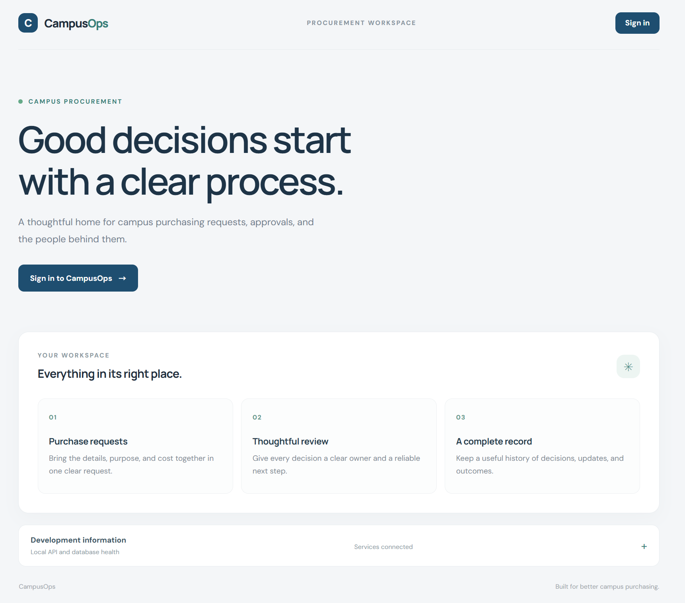
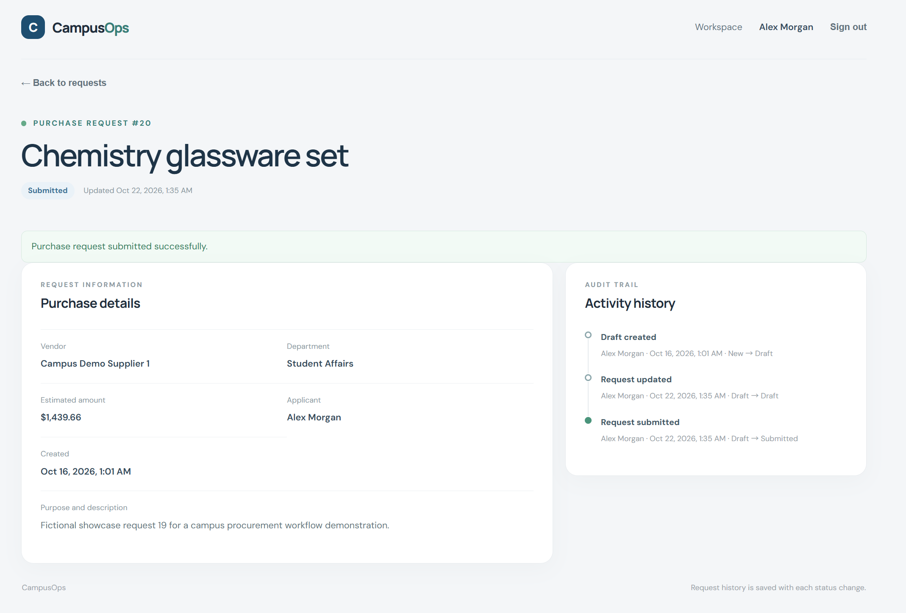
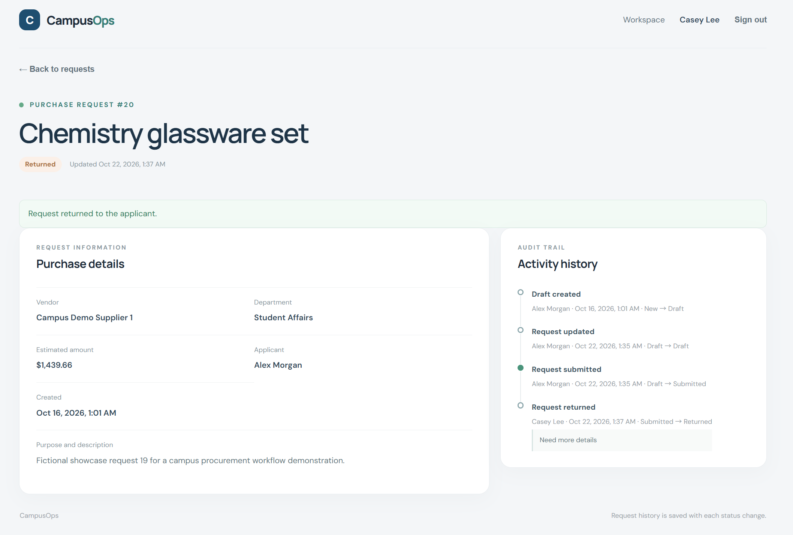

# CampusOps Screenshot Showcase

These screenshots show the real CampusOps application using fictional demonstration accounts and request data. The project is an independent development demonstration and has not been put into use by any school.

## 01. CampusOps Home Page

The public landing page introduces the procurement workspace and provides a sign-in entry point. The development information panel shows the local service health status.

## 02. Administrator Workspace and Overview

The administrator workspace summarizes all requests with status and department overviews, followed by the request register.

## 03. Submitted Requests Sorted by Amount

The request register is filtered to Submitted status and sorted by amount from highest to lowest. This view demonstrates status filtering and amount sorting.

## 04. Applicant Workspace

The applicant workspace shows Alex Morgan's requests, filtered overview cards and charts, and the option to create a request.

## 05. Successfully Submitted Request

This request detail page confirms a successful submission and displays the request information and activity history.

## 06. Administrator Review

The administrator review page provides an optional approval comment and a required return reason before a decision is made.

## 07. Returned Request and Reason

This administrator view shows the returned result and its reason in the activity history.

## 08. Approved Result and Complete History

The final detail page shows the Approved status and the full sequence of creation, submission, return, update, resubmission, and approval events.

